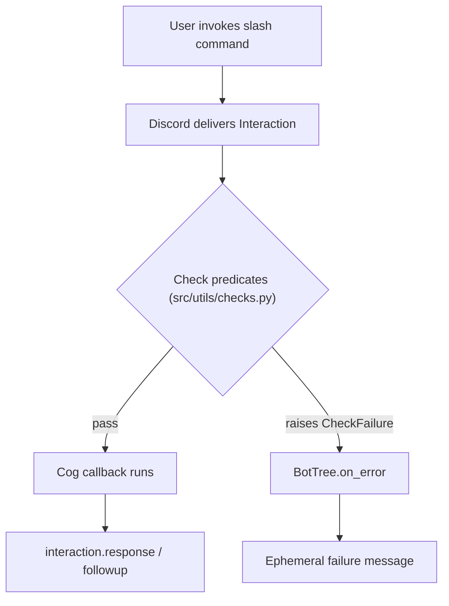

# Architecture

How this template is built: components, responsibilities, contracts between
them, and runtime flows. Operating rules live in [`AGENTS.md`](AGENTS.md);
porting an existing bot into this format is covered by
[`MIGRATION.md`](MIGRATION.md).

## Stack

| Component    | Version / choice                  |
| ------------ | --------------------------------- |
| Python       | >= 3.13                           |
| Discord API  | `discord.py` >= 2.7.1             |
| Env loading  | `python-dotenv`                   |
| Hot reload   | `watchfiles`                      |
| Dependency m | `uv` (`pyproject.toml` + `uv.lock`) |

## Guiding principles

1. **`main.py` is the only entrypoint.** It wires configuration, logging, and
   the `Bot` subclass; nothing imports it.
2. **Convention over configuration.** There is no manual cog list: anything in
   `cogs/` that satisfies the extension contract is discovered and loaded. The
   auto `/help` is generated from command names and descriptions — no command
   help to maintain.
3. **Slash commands are the user surface.** Every user-facing feature is an
   `@app_commands.command`. The `!` prefix is reserved for owner operations in
   `cogs/owner.py` and never appears in `/help`.
4. **Infrastructure is centralised in `src/utils/`.** Cogs stay thin: command
   definitions and feature logic only.
5. **Quiet in chat, loud in logs.** Permission failures get short ephemeral
   replies; unexpected errors are logged with tracebacks and answered with a
   generic ephemeral message.

## Component map

```
main.py                    # entrypoint: env, logging, Bot subclass, setup_hook
cogs/                      # feature layer (auto-discovered)
  __init__.py              # auto-loader: load_cogs(bot)
  owner.py                 # ! prefix ops: sync/cogs/load/unload/reload/shutdown
  help.py                  # /help rendered from the command tree
  ping.py                  # minimal example cog
  template.py              # copy-paste snippet, intentionally ignored by loader
src/                       # shared infrastructure (never auto-reloaded)
  utils/
    constants.py           # PROJECT_ROOT, COGS_PATH, IGNORED_COGS
    logging.py             # setup_logging(): console + rotating file handler
    tree.py                # BotTree: application-command error handling
    checks.py              # permission decorators + CheckFailure types
    embeds.py              # /help page builder
    pagination.py          # Paginator view (author-locked buttons)
    reloader.py            # CogReloader: watchfiles watcher over cogs/
```

## Bootstrap sequence

```
.env ──load_dotenv()──▶ DISCORD_TOKEN, LOG_LEVEL, LOG_DIR, AUTO_RELOAD
main.py
  ├─ setup_logging()              once, on the root logger
  ├─ TOKEN check                  raises ValueError if DISCORD_TOKEN unset
  ├─ Bot(command_prefix="!",
  │     intents=Intents.all(),
  │     tree_cls=BotTree)         single wiring point for the command tree
  ├─ client.run(token, log_handler=None)   suppresses discord.py's own logging
  └─ setup_hook()
       ├─ load_cogs(bot)          discovers and loads every cog
       ├─ await tree.sync()       registers slash commands globally
       └─ CogReloader(bot).start()  background watcher task
```

`setup_hook` imports the loader and reloader lazily inside the function, so the
only hard imports in `main.py` are `src.utils.logging` and `src.utils.tree`.

## Cog discovery (the extension contract)

`cogs/__init__.py::load_cogs` scans `COGS_PATH` in sorted order:

- Skip entries in `IGNORED_COGS` (`{"__init__.py", "template.py"}`) and names
  starting with `_`.
- **File cog:** `cogs/<name>.py` → extension `cogs.<name>`.
- **Folder cog:** `cogs/<name>/` with an `__init__.py` → extension `cogs.<name>`;
  the `async def setup(bot)` entrypoint lives in that `__init__.py`, and other
  modules in the folder belong to the same package (internal relative imports
  are fine).
- Each extension must expose `async def setup(bot: commands.Bot)`.
- A load failure is logged and the cog is **skipped**, not fatal — so a missing
  command usually means a load error. Check `logs/bot.log`.

Names must be valid Python module names (letters, digits, underscores; no
hyphens or spaces) because the extension name maps directly to the path.

### Cog anatomy

```python
import discord
from discord import app_commands
from discord.ext import commands

from src.utils.checks import is_mod


class MyFeature(commands.Cog):
    def __init__(self, bot: commands.Bot):
        self.bot = bot

    @app_commands.command(name="feature", description="Shown by /help.")
    @is_mod()                       # checks sit below @app_commands.command
    async def feature(self, interaction: discord.Interaction, ...):
        ...


async def setup(bot: commands.Bot):
    await bot.add_cog(MyFeature(bot))
```

## Command execution flow



`BotTree` (`src/utils/tree.py`, wired via `tree_cls=BotTree`) is the single
error-handling point for application commands. Its `on_error`, in order:

1. If the interaction was already answered (e.g. by a local `@cmd.error`
   handler), do nothing.
2. Failures raised by `checks.py` types (`OwnerOnly`, `AdminOnly`, `ModOnly`,
   `MissingPermissions`) → reply `str(error)`.
3. Any other `CheckFailure` (including parameter-converter errors, which
   discord.py raises as a `CheckFailure`) → generic "You do not have
   permission…".
4. Anything else → log with traceback, reply "Something went wrong…" — all
   ephemeral.

## Permission model

`src/utils/checks.py` provides decorators returning `app_commands.check`
predicates. Each raises its own `app_commands.CheckFailure` subclass so
`BotTree` can produce the right ephemeral reply.

| Decorator                | Passes when                                   |
| ------------------------ | --------------------------------------------- |
| `is_bot_owner()`         | `bot.is_owner(user)` (application team)       |
| `is_admin()`             | Member has the Administrator permission       |
| `is_mod()`               | Administrator **or** any moderator permission |
| `has_permissions(**kws)` | Member has every named permission             |
| `is_bot_owner_prefix()`   | `bot.is_owner(author)` — for **text** commands (app-command checks do nothing on prefix commands) |

Moderator permissions (`MODERATOR_PERMISSIONS` in `checks.py`):
`manage_messages`, `kick_members`, `ban_members`, `moderate_members`,
`manage_threads`, `manage_channels`. Permissions are read from
`interaction.user.guild_permissions` (None in DMs, so mod checks fail closed).

## Supporting modules

| Module                   | Responsibility                                                                 |
| ------------------------ | ------------------------------------------------------------------------------ |
| `src/utils/constants.py` | Repo-level constants: `PROJECT_ROOT` (`parents[2]`), `COGS_PATH`, `IGNORED_COGS`. Add new shared paths/flags here, not in `cogs/__init__.py`. |
| `src/utils/logging.py`   | `setup_logging()` — called exactly once, in `main.py`. Configures root-logger console output plus a rotating handler (5 MB × 5 files) writing `<LOG_DIR>/bot.log`. Cogs just use `logging.getLogger(__name__)`. |
| `src/utils/embeds.py`    | `build_help_pages()` — flattens `bot.tree.get_commands()` into sorted `(name, description)` entries; groups ≤ 8 per page; falls back to "No description provided." |
| `src/utils/pagination.py`| `Paginator` — embed-view with Previous / page-counter / Next buttons; only the invoking user may navigate; 180 s timeout. Used by `/help` when there is more than one page. |
| `src/utils/tree.py`      | `BotTree` — see command execution flow above. |
| `src/utils/checks.py`    | Permission decorators — see permission model above. |

## Command-tree sync, reload, and auto-reload

- A **global** `tree.sync()` runs once in `setup_hook`, so slash commands exist
  without manual syncing.
- `cogs/owner.py` provides owner ops to rebalance: `!sync` (global),
  `!sync guild` (copy global commands into one server for fast testing),
  `!sync clear` (empty that server's copy). Needed after renaming a command.
- `CogReloader` (`src/utils/reloader.py`) watches `cogs/` with `watchfiles`:
  added/modified `.py` files map to `cogs.<stem>` (a nested file reloads its
  package). Skips `__pycache__`, `_`-prefixed names, and `IGNORED_COGS`.
  Controlled by `AUTO_RELOAD`; watches nothing under `src/` or `main.py`.
- Reloading updates the in-memory command tree but **does not** call
  `tree.sync()`: sync policy is never the reloader's job.

## Configuration

| Env var         | Default | Meaning                                            |
| --------------- | ------- | -------------------------------------------------- |
| `DISCORD_TOKEN` | —       | Required; startup raises if unset. Only token name read. |
| `LOG_LEVEL`     | `INFO`  | Root logger level (case-insensitive).              |
| `LOG_DIR`       | `logs`  | Directory for rotating `bot.log` (gitignored).     |
| `AUTO_RELOAD`   | `true`  | Enables the `CogReloader` watcher.                 |

`Intents.all()` is requested, so the Discord Developer Portal must have
**Message Content**, **Server Members**, and **Presence** elevated intents
toggled on — otherwise login fails with `PrivilegedIntentsRequired`.

## Persistence

The template ships no database or file storage. Cogs that need state should
keep it under a single `data/` directory at the repo root (gitignored), with
the path defined in `src/utils/constants.py`. Migration guidance for existing
bots: `MIGRATION.md`.

## Operational surface

Owner-only prefix commands in `cogs/owner.py`, guarded by
`is_bot_owner_prefix()`: `!sync [global|guild|clear]`, `!cogs` (loadable names
mirror the auto-loader's rules), `!load` / `!unload` / `!reload`, `!shutdown`.
`cogs.owner` itself refuses to be unloaded (it would strand the `!` commands).
Prefix-command errors are handled by that cog's `cog_command_error`.

## Where to add things (extension points)

| Need                         | Place                                       |
| ---------------------------- | ------------------------------------------- |
| New user-facing feature      | `cogs/<name>.py` (or a `cogs/<name>/` folder) |
| Shared helper reused by cogs | new module in `src/utils/`, imported absolutely (`from src.utils.x import ...`) |
| Shared constant/path         | `src/utils/constants.py`                    |
| Another owner op             | `cogs/owner.py`                             |
| New permission tier          | `checks.py` (new `CheckFailure` subclass + helper; add it to `CHECK_FAILURES` in `tree.py` for the tailored reply) |
| New env var                  | `.env.example` + document here and in `AGENTS.md`; read with `os.getenv` |

## Documentation map

| Doc                | Scope                                                    |
| ------------------ | -------------------------------------------------------- |
| `ARCHITECTURE.md`  | This file: architecture, contracts, flows.               |
| `AGENTS.md`        | Operational rules and commands for working on the repo.  |
| `MIGRATION.md`     | Porting an existing discord.py bot into this format.     |

Architecture changes (layout, entrypoint, loading rules, `src/utils`
contracts, constants, env vars, command/permission philosophy) must be
reflected in this file **and** `MIGRATION.md`; see the sync rule in
`AGENTS.md`.
